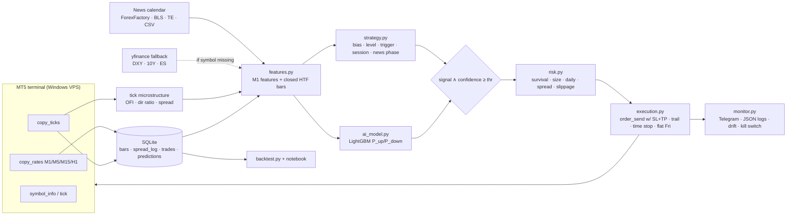

# XAUUSD AI scalper — architecture (v2)

This `bot/` package is a fresh, spec-driven engine. It sits alongside the existing Codex build in the
repo root (`goldbot.py`, `engine.py`, …), which stays untouched and runnable.

## How it relates to the Codex build

| Area | Codex build (root) | v2 (`bot/`) | Plan |
|---|---|---|---|
| Signal | Tick impulse inside 2 s buckets, 180 s hold | M15 bias → M5 key level → M1 trigger, 1–15 min hold | v2 |
| Model | Logistic regression (buy/sell/wait) + online logistic adjustment | LightGBM P(up) 25 min ahead, weekly walk-forward retrain, drift monitor | v2 |
| History | 14 days of ticks | 3 years of M1 (+ ticks where the broker has them) | v2 |
| Risk | 0.1 %/trade, 1 % daily stop, 1 position | 0.5 %/trade, 2 % daily, 2 concurrent, 20/day, survival rule, spread/slippage filters | v2 |
| News | Block T−10 … T+5 (BLS/TE calendars, point-in-time snapshots) | Pre-block, news-scalp window, post-event wider SL | v2 logic, **reuse Codex calendar feeds** |
| Order journal / reconcile after crash | Strong: intent recorded before submit, reconcile by tag | – | **Reuse** (port `journal.py`) |
| Gold symbol / suffix detection | `resolve_gold`, alias lists | Ported into `data.py` | Done |
| Windows runner, START.cmd, release packaging | Done | – | **Reuse**: point it at `bot/main.py` |

## Data flow

## Modules

| File | Status | Contents |
|---|---|---|
| `config.yaml`, `config.py` | ✅ | Every tunable; secrets from `.env` |
| `data.py` | ✅ | MT5 connect/reconnect (30 s × 10 min), server-time → UTC, gold/correlated symbol resolution, chunked rate & tick download, tick microstructure, SQLite store, incremental sync, CSV loader, yfinance fallback |
| `features.py` | ✅ | Indicators (RSI, MACD, ATR, %B, VWAP, OBV slope, ADX, Stoch), look-ahead-safe HTF alignment, regime/session/event/correlated features, label |
| `strategy.py` | ✅ rules | M15 bias, key levels (VWAP, prior H1 H/L, fib .618/.786), M1 trigger, sessions, news phases |
| `risk.py` | ✅ | Sizing, survival rule, daily state, entry gating |
| `backtest.py` | ✅ | Bar-by-bar engine with every §3/§5/§6 rule, cost model, metrics, baselines, walk-forward windows |
| `tools/probe_symbols.py` | ✅ | Run on the VPS — confirms symbols, spec, offset, history depth |
| `ai_model.py` | ✅ | LightGBM, walk-forward OOS + holdout, SHAP (TreeSHAP via pred_contrib), drift monitor |
| `news.py` | ✅ | ForexFactory weekly feed + Codex BLS calendar import + manual CSV, NFP rule for history |
| `execution.py` | ✅ | Market orders with SL/TP attached, trailing via SLTP modify, closes, P&L from deal history |
| `live.py` | ✅ | Watch/demo loop, per-bar decision, trailing/time stop/pre-news tighten, survival/daily stops, drift pause |
| `monitor.py` | ✅ | JSON logs (7-day rotation), Telegram alerts + /status /pause /resume /stop, heartbeat |
| `background.py`, `main.py`, `START.cmd` | ✅ | Menu launcher, Task Scheduler logon runner, kill switch, Codex data import |
| `prepare.py` | ✅ | History download → walk-forward → backtests vs baselines → HTML report (equity, DD, monthly, SHAP) |
| `packaging/build_windows.py` | ✅ | Self-contained zip with embedded Python 3.12 (buildable from Linux too) |

## PUPrime symbols (confirmed from the Codex data, demo server PUPrime-Demo)

Standard account suffix `.s`: gold `XAUUSD.s` (100 oz, 0.01 lot step, fixed ~$0.32 spread), dollar index `USDX.s`,
S&P 500 `SP500.s`, plus NAS100.s, VIX.s, XAGUSD.s, EURUSD.s, USDJPY.s, USOUSD.s. **No US 10Y yield symbol**, so that
feature stays empty.

## Decisions and caveats

* **Time**: MT5 returns server time (PUPrime is usually UTC+2/+3 with DST). Everything is converted to UTC; offset auto-detected or set in config.
* **No look-ahead**: higher-timeframe values join on bar *close* time; decisions at M1 close fill at the next bar's open.
* **Fills**: bars are bid; longs pay ask. SL/time/forced exits pay slippage, TP is a limit. SL is assumed first when a bar hits both.
* **Sunday window**: the market opens at 22:00, so "Sunday 21:00–22:00 no entries" is always closed already. I also block **22:00–23:00 Sunday**, the real post-reopen spread spike. Remove it in `config.yaml` if you disagree.
* **Daily loss limit**: on hit, open positions are closed too ("halt all trading").
* **Cost reality check**: your cost model (2 pips = $0.20 slippage *per side* + $0.10 spread + commission) is about $0.52/oz round trip. With SL = 1 × ATR(M5) (often $1.5–4 on gold) that is 15–35 % of the risk on every trade. That's the main hurdle for this strategy to show an edge. Phase 2 demo logs will show the real slippage, which on ECN is usually well below 2 pips.
* **History depth**: MT5 brokers often serve less than 3 years of M1. If the probe shows a shorter range, load extra history via `data.load_csv_bars` (Dukascopy / HistData export). Free sources can't give **3 years of 1-minute** DXY/10Y/ES. If PUPrime lacks those symbols' history, the correlated features stay NaN in training (LightGBM handles missing values) and are used live only.
* **MT5 calendar**: the Python `MetaTrader5` package does **not** expose MT5's economic calendar (MQL5 only). Use ForexFactory / the Codex BLS+TE feeds, or a small MQL5 script exporting the calendar to CSV.
